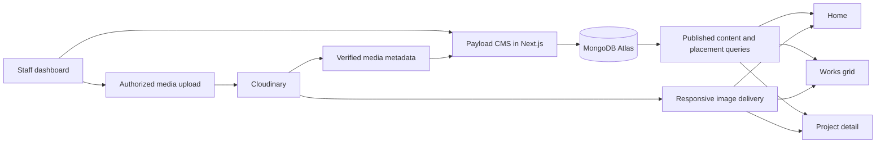

# TRAIL9INE MEDIA — Agency platform audit and development plan

Date: 10 November 2026. Status: proposal for staged approval; application changes have not started.

## 1. Product objective and agreed requirements

Present the agency's services and real project work with a professional, deliberately designed public website. Give nontechnical staff a clear dashboard for creating, editing, arranging and publishing portfolio projects without developer assistance.

Requirements recorded from the owner's brief:

- Navigation: Home, Works, About Us, Services, Contact Us. Services exposes links to all service detail pages on desktop and mobile.
- Projects created in the dashboard populate the Works grid and their own detail pages from the database.
- Separate controls decide whether a published project appears on Home and on Works.
- Staff manage cover images, gallery images, videos, descriptions and remaining project information.
- Works and project detail layouts remain customizable; the dashboard must reflect the available layouts and their fields.
- Use MongoDB for content records and an external media platform for files.
- Home prominently presents services and selected projects.
- Use cohesive typography, thoughtful composition and restrained animation, including small Lottie assets where useful.
- Review and approve each major direction before implementing the next stage.

## 2. Audit scope and evidence

This is a source and architecture audit across public routes, shared components, Payload collections/globals/admin setup, project queries, contact/notification APIs, scripts, configuration, tests and project documentation. It is not a fresh authenticated browser usability assessment, a live provider integration test or a production load test.

Baseline verification performed in this chat: TypeScript passed; 28 tests passed across four suites. Database tests used a disposable copy of the local SQLite database. No production build or new browser review has been completed in this audit. Passing existing tests does not establish coverage of the gaps below.

The existing Next.js/React/Payload foundation can be retained. A full backend rewrite is unnecessary for the requested workflow.

### Current capabilities and gaps

| Area | Current evidence | Required change |
| --- | --- | --- |
| Project authoring | `src/collections/Projects.ts` includes project details, categories, images, gallery, SEO, drafts and preview configuration. | Keep the content foundation; simplify the editing experience and add layout/visibility controls. |
| Works listing | `src/app/(site)/work/page.tsx` reads published records, supports category filters and pagination. | Add explicit Works visibility, coherent card presentation and configurable listing settings. |
| Project detail | `src/app/(site)/work/[slug]/page.tsx` renders saved project fields and gallery modules. | Add approved layout variants and complete the field-to-renderer contract. |
| Home projects | `src/app/(site)/page.tsx:8` selects the first four published projects. `Projects.ts:338` declares `featured`, but the public query does not use it. | Connect the Home switch, order and section limit to real selection logic. |
| Works visibility | `src/lib/public-projects.ts:23` has no separate listing visibility filter. | Add `showOnWorks`; apply placement rules consistently to listings and recommendations. |
| Navigation | `src/components/public/Header.tsx:7` has Work/About/Services/Contact; no Home item or service submenu. | Implement requested labels, exact Home active state, accessible dropdown and mobile accordion. |
| General site content | Home/About/SiteSettings globals exist, but public templates do not call `findGlobal`; services live in `src/lib/studio-content.ts`. | Connect public content to CMS records, including service navigation and detail content. |
| Database | `src/payload.config.ts` selects SQLite or PostgreSQL. MongoDB is not installed/configured. | Introduce Payload's MongoDB adapter and a verified data migration. |
| Media | `src/collections/Media.ts` uses local uploads; `payload.config.ts` optionally enables S3. URL fallback fields also exist. | Add an integrated media workflow using the chosen provider. |
| Image delivery | `Studio.tsx:16` bypasses Next optimization for WebP and remote URLs. Gallery rendering often substitutes captions for media alt text. | Generate responsive provider URLs, preserve alt text/dimensions and provide crop/focal-point controls. |
| Dashboard presentation | Native Payload lists/forms and project tabs; no tailored agency overview or visual project editor. | Add branded, task-focused views and components while retaining Payload auth/versioning. |
| Admin component registration | Generated `admin/importMap.js` exists, but admin layout/page/not-found pass empty import maps. | Wire the generated import map before relying on custom admin components. |
| Templates | Gallery has six module types. `wideImage` and `captionedImage` currently share rendering; ratios are largely CSS-defined. | Formalize shared modules and explicit presentation options rather than maintaining unrelated forms. |
| Recommendations | Detail page loads only the first 100 published projects to resolve the next project. Service-related projects are hardcoded by slug. | Query selected relationships directly, with deterministic eligible fallback rules. |
| Styling/motion | `globals.css` contains multiple successive hero revisions. `HeroMotion`/`ButtonRoll` are outside the current Home rendering path. No active Lottie integration found. | Consolidate styles after design approval; retain only deliberate animation and components. |
| SEO | Basic metadata exists; no app sitemap/robots files found. | Add sitemap/robots/canonicals and route-update behavior after visibility rules are implemented. |

### Integrity and access gaps to fix with the foundation

These are source findings, not claims of exploits reproduced against a live deployment.

1. `NotificationOutbox.ts:13–14` permits unauthenticated creation/update. Public collection APIs must not treat an anonymous caller as a trusted system worker.
2. `Inquiries.ts:13` permits direct public collection creation. That path does not enforce the custom contact endpoint's complete rate-limit, honeypot and outbox workflow. Close public writes to operational collections and use validated server operations.
3. `Projects.ts` marks `approach` as internal in its label but gives it no field-level read restriction. Omitting it from the visible page does not protect it in the public collection API. Restrict internal fields and verify public API responses.
4. `notifications/webhook/route.ts` updates delivery status without checking the configured Resend signing secret.
5. The contact API creates inquiry and outbox records separately without a shared transaction. Its idempotency key is indexed but not unique, leaving a concurrent duplicate race.
6. Worker leases use find-then-unconditional-update, so concurrent workers can claim the same notification. Immediate sends and manual retries are separate dispatch paths and can race with workers.
7. The HTTP worker exception path can retry without enforcing its normal maximum-attempt rule; CLI/HTTP worker logic is duplicated. Consolidate claims, retry bounds and status transitions, and use provider idempotency where supported. Do not promise exactly-once delivery.
8. Missing Resend credentials return a simulated success in all environments. Permit simulation only in explicit development/test mode; fail clearly in production.
9. Payload and worker secrets have known fallback values. Production must validate required environment values at startup.
10. `Users.ts` defaults new users to editor and does not implement the README's automatic first-owner assignment. Secure and verify first-owner provisioning.
11. Project draft reads currently allow any authenticated user, while staff preview restricts owner/editor. Apply one role policy consistently.
12. Existing access tests use privileged Local API defaults and explicit published filters; they do not prove anonymous access restrictions. Add real role/anonymous API coverage.

## 3. Recommended architecture

### Database: MongoDB Atlas

Use MongoDB Atlas with Payload's official `@payloadcms/db-mongodb` adapter, matching the installed Payload package version. Store projects, categories, services, page content/settings, media metadata, users, inquiries and notification jobs. Files stay in media storage; do not store image/video binaries or base64 data in project documents.

Payload officially supports MongoDB, so the existing collection concepts remain useful. This does not make migration a connection-string-only change. [Official MongoDB adapter documentation](https://payloadcms.com/docs/database/mongodb).

### Media: Cloudinary recommendation

Cloudinary is the recommended fit for this project's editing and presentation needs: a dashboard upload interface plus image transformations and delivery. Use a custom authenticated integration; this is not currently installed in the project. Upload signatures are created server-side after role checks. Verify provider results before persisting asset references. [Upload widget](https://cloudinary.com/documentation/upload_widget), [image optimization](https://cloudinary.com/documentation/image_optimization).

| Option | Proposed use | Tradeoff |
| --- | --- | --- |
| Cloudinary | Recommended primary image/media library with uploads inside this dashboard. | Custom Payload integration; storage, transformations and bandwidth must be sized to expected usage. |
| Google Drive | Optional later import source for agency assets. | Share/download links depend on file access and are a different workflow from optimized website image delivery. Import approved files into the media library instead of assuming every share link is an image URL. |
| S3-compatible storage / Cloudflare R2 | Alternative if object storage is preferred. Existing project already has an S3 integration starting point. | We would separately design the uploader, image processing/crops and delivery behavior. |

The Drive recommendation is an architectural judgment based on its permission/download model; it is not a claim that Drive cannot serve any public files. [Drive download documentation](https://developers.google.com/workspace/drive/api/guides/manage-downloads), [R2 overview](https://developers.cloudflare.com/r2/).

Keep launch media scope simple: images through Cloudinary, existing YouTube/Vimeo/Instagram support retained. Agree on direct video size/duration limits before enabling large video uploads. Provider plan selection depends on real image counts, original sizes, visitor traffic and video use; no fixed monthly cost or unlimited free use is assumed.

### Hosting

Retain Next.js with a Node-compatible deployment that supports Payload and MongoDB connectivity. Confirm the intended hosting environment during foundation setup. Use staging and production databases/provider environments separately. Provider accounts and secrets will be needed for live integration testing; they are not needed to approve the UX direction.

## 4. Exact project visibility contract

Proposed fields: `showOnHome`, `showOnWorks`, `homeOrder`, `workOrder`; keep Payload draft/publish status as the authority for public availability. Map the current `featured` field to `showOnHome` during migration.

| Status | Home switch | Works switch | Home | Works grid | Public detail URL |
| --- | --- | --- | --- | --- | --- |
| Draft | Any | Any | Hidden | Hidden | 404; authorized preview only |
| Published | On | On | Eligible | Visible | Available |
| Published | On | Off | Eligible | Hidden | Available |
| Published | Off | On | Hidden | Visible | Available |
| Published | Off | Off | Hidden | Hidden | Available by direct URL |

The two switches control placement, not privacy. The editor explains that unpublishing is how to remove public detail access. Published records hidden from both placements are omitted from automated sitemap/service recommendations/next-project fallbacks by default; a direct URL remains public. Explicit no-index control can be added if an unlisted public page is needed, but no-index is not access protection.

Home uses only published Home-enabled projects, ordered by `homeOrder` with a stable secondary sort and a configurable maximum. More selected projects than available slots trigger an editor explanation; choosing Home does not promise a visible slot if the section limit is exceeded. No silent fallback to unselected projects. Works uses its own ordered query and pagination. Suggested defaults for new projects: draft, Home off, Works on.

Published edits invalidate affected listings, detail pages and related content. Slug changes preserve old links through redirects. Unpublishing invalidates public routes and removes recommendations. Draft editing must not leak unpublished revisions of previously published projects.

## 5. Dashboard UX proposal

Build on Payload's customization model instead of adding a second authentication/content system. [Payload custom components](https://payloadcms.com/docs/custom-components/overview).

Navigation: Overview, Projects, Media Library, Services, Website Content, Inquiries, Settings. Staff accounts and system controls are role-restricted. Hide raw outbox/debug fields from everyday editing.

### Overview and project list

- Overview shows actual published/draft project counts and permitted inquiry information; primary action is Add Project.
- Projects show cover thumbnails, title, client, publication status, Home/Works badges and last updated date.
- Search and filters cover publication status, categories and placements.
- Provide Edit, Preview and View Live actions; destructive actions require explicit confirmation.
- Use clear loading, empty, saved and failed states. Do not invent analytics or engagement numbers.

### Project editor

| Step | Staff-facing controls |
| --- | --- |
| 1. Project information | Project name, client, short introduction, services, category; editable URL under advanced options. |
| 2. Cover and gallery | Upload / Select from library, thumbnail previews, alt text, caption, focal crop, multi-image upload, reorder and replace. |
| 3. Project story | Overview, optional public narrative sections and reorderable gallery blocks. Internal notes stay clearly separate and private. |
| 4. Appearance | Approved layout preset, allowed hero/gallery options and desktop/mobile preview. |
| 5. Visibility and publish | Home switch, Works switch, ordering, Save Draft, Preview and Publish. SEO fields sit in an advanced panel. |

These can be clear sections/tabs with persistent actions rather than a forced multi-page wizard. Publishing shows actionable missing-field messages. Upload progress/retry and unsaved-change protection are required. Saved draft and published versions have clear labels.

Usability acceptance: a person unfamiliar with the code can create a project, upload a cover and gallery, preview it, choose placements, publish, edit a caption and unpublish without entering IDs, JSON, provider credentials or technical block names.

### Media contract

Store a media record with provider, public/asset ID, version, resource type, secure URL, width, height, format, bytes, alt text, optional caption and focal point. Projects reference media records instead of repeating raw links. Define one primary upload pipeline so files are not unintentionally uploaded to both local/S3 storage and Cloudinary.

Validate upload type/size/count and authorization server-side; signing presets enforce restrictions. Track use before deleting an asset. Replacing an image refreshes delivery URLs without breaking unrelated projects. A failed/abandoned upload must not prevent saving text or leave unlimited orphaned media. If Drive import is added later, handle access errors explicitly and restrict remote fetch destinations rather than fetching arbitrary URLs from the server.

## 6. Customizable presentation without mismatched forms

Treat Works listing layout and individual project layout as separate settings.

- Works settings: approved grid preset, columns at each breakpoint, image ratio, card information, spacing, filter visibility and pagination size.
- Project settings: approved detail preset, hero aspect/crop, gallery arrangement and allowed narrative modules.
- Proposed initial detail families for review: Editorial, Film-focused and Photography-focused. Start by approving one default; add variants only where the content benefits.
- Shared module definitions connect CMS fields, validation, previews and frontend rendering. Use stable keys and a schema version.
- Selecting a preset reveals only its relevant controls. Switching presets preserves existing content and explains incompatible modules before saving.
- New template fields include migration/default rules for existing projects; old projects must remain renderable.
- Distinguish public narrative from private production notes with field-level access restrictions.

The initial module set can reuse wide image, image pair, portrait strip, video, captioned image and text, with human-readable names and thumbnail previews. Avoid building an unrestricted page builder before the agency's actual layouts are approved.

## 7. Public website direction

Recommended direction for approval: a portfolio-led creative agency site using the existing plum/charcoal identity, Manrope/Inter, strong photography, precise spacing and clear service descriptions. Final composition, logo use and layout are subject to the owner's review. Show supplied agency/client assets as client work; do not substitute generated concept images as proof of real projects.

- Header: Home / Works / About Us / Services / Contact Us. Keep existing route paths where possible. Services has a separately operable menu toggle and an overview link; all five details remain directly accessible. Support keyboard, Escape, focus states and touch.
- Home: concise positioning and primary contact/work actions; selected project showcase; five clearly presented services; studio introduction; process; contact invitation. Final section order is reviewed in the wireframe.
- Works: legible responsive grid, real category filters, clear View Project affordance and meaningful empty states.
- Project detail: saved content, approved media layout, relevant services, next eligible project and inquiry action.
- Services: CMS-managed shared source powers Home, navigation, overview and details. Preserve the existing contact service identifiers through an explicit mapping.
- About and shared content: connect approved copy, contact information and footer settings to the CMS.
- Motion: begin with one or two small branded Lottie accents if approved assets are available. Use light hover/reveal transitions, lazy load animation, pause offscreen and honor reduced-motion preferences. Assess motion against the actual page, not an animation count.

Design review includes Home, Works, one project detail and the editor on desktop/mobile before the entire site is restyled.

## 8. MongoDB and media migration plan

1. Establish a recoverable source snapshot and version control before implementation. Inventory records, media paths, drafts, versions, users and notification jobs without exposing secrets or personal data in the report.
2. Pin compatible Payload packages; add the MongoDB adapter and validate configuration. Do not automatically upgrade the whole stack as part of the adapter switch.
3. Create an explicit ID map from existing SQLite IDs to destination IDs. Import categories/media/users before relationships, then projects, project links, inquiry/outbox links and globals. Include versions where practical; document any version-history limitation before cutover.
4. Preserve staff authentication using a compatible, verified migration strategy. If password hashes cannot be preserved through supported tooling, agree on secure account re-provisioning/password reset before launch; never silently lose access.
5. Transfer media with an idempotent manifest of source path, destination asset ID and status. Preserve originals until verification. Local public image assets can remain initially; migrate selected actual library assets deliberately.
6. Map `featured` to Home placement; default existing public portfolio projects to Works-visible and preserve established ordering. Seed CMS services/page content from the current rendered content rather than outdated global defaults.
7. Dry-run migration against staging; compare counts, slugs, relationships, field contents, image availability and staff login. Re-running must not duplicate data.
8. At cutover, stop writes/workers temporarily, capture final changes, verify destination and switch configuration. Do not replay completed email jobs or send old inquiries again.
9. Keep the prior database/media snapshot and configuration rollback path until acceptance. Choose backups and verify restore procedure for the actual Atlas plan; do not assume free-tier features meet launch needs.

This migration is a separate deliverable from installing an adapter. Production data/account changes happen only at the agreed rollout stage.

## 9. Implementation stages and review gates

| Stage | Concrete deliverable | Review/exit condition |
| --- | --- | --- |
| 0. Audit and plan — current | This audit, architecture recommendation, visibility contract and staged scope. | Owner approves direction or requests changes. |
| 1. UX and visual direction | Reviewable desktop/mobile layouts for navigation, Home, Works, project detail, dashboard list and project editor. Final field map and template behavior. | Owner approves the screens and workflow before schema/UI implementation. |
| 2. Foundation | MongoDB adapter, staging configuration, media upload/library integration, access fixes, shared queries and migration rehearsal tools. | Authorized upload and database round trip work on staging; access checks pass; no source data is lost. |
| 3. Portfolio dashboard | Branded overview, project list/editor, visibility/order controls, module previews, save/preview/publish and media lifecycle. | The nontechnical editor journey is demonstrated and approved. |
| 4. Public experience | Approved navigation, Home/services showcase, Works grid and detail layouts connected to the same schema; CMS-managed page/service content. | End-to-end publication and approved desktop/mobile design are demonstrated. |
| 5. QA and rollout | Remaining notification fixes, role/API/browser checks, SEO/performance pass, migration reconciliation, backup/rollback and staff handover. | Owner accepts staging; agreed production migration/deployment follows. |

Each stage produces a concrete reviewable result. Implementation proceeds stage by stage after approval, as requested; avoid repeated permission checks for routine work within an approved stage.

## 10. Acceptance checks before completion

- Create a new draft, upload images, arrange sections and preview it as authorized staff; anonymous visitors cannot see it.
- Publish it and verify title, cover, copy, media order and detail URL match the dashboard.
- Verify all visibility combinations in section 4, including more Home selections than available slots and no eligible Home projects.
- Edit an existing published project as a draft; confirm the old live revision remains public until publish. Publish and verify updated content without a manual rebuild.
- Change layouts and switch back; preserve content. Confirm legacy projects render after schema changes.
- Filter/paginate Works; verify empty states and ordering. Check next/related links against publication and placement rules, including projects beyond the first 100.
- Change slug and verify redirect; unpublish and verify detail 404, recommendation removal and sitemap behavior.
- Upload, retry a failed upload, replace media and attempt to delete an in-use asset. Verify desktop/mobile crops, alt text and responsive image sizes.
- Confirm service edits appear consistently in the menu, Home and detail pages and preserve correct contact preselection.
- Exercise dropdown/mobile navigation with keyboard and touch, contact validation, reduced motion and narrow layouts at 320/390/768/1024/1440px.
- Test owner/editor/inquiry-manager/anonymous access with access enforcement and real API requests. Verify private fields, draft media policy and operational collections.
- Verify signed notification webhooks, bounded retries, concurrent job claims, duplicate submission handling and production behavior with missing credentials. Use test delivery recipients for provider checks.
- Run TypeScript, meaningful unit/integration tests, production build and browser journey checks against MongoDB staging. Existing SQLite tests alone do not certify the new adapter.
- Reconcile migration counts/relationships, verify staff login, inspect actual client assets, test rollback/restore and provide a short staff editing guide.

## 11. Next approval

Recommended decision: retain Next.js + Payload, adopt MongoDB Atlas + Cloudinary, approve the independent Home/Works visibility contract, and start Stage 1 with a portfolio-led agency direction and a simplified project editor.

No provider account has been provisioned, no database has been migrated, and no public/admin application code was changed by this planning task.
